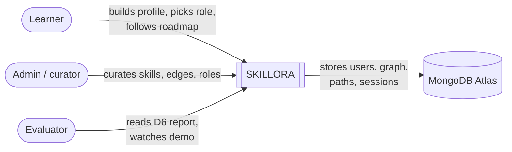
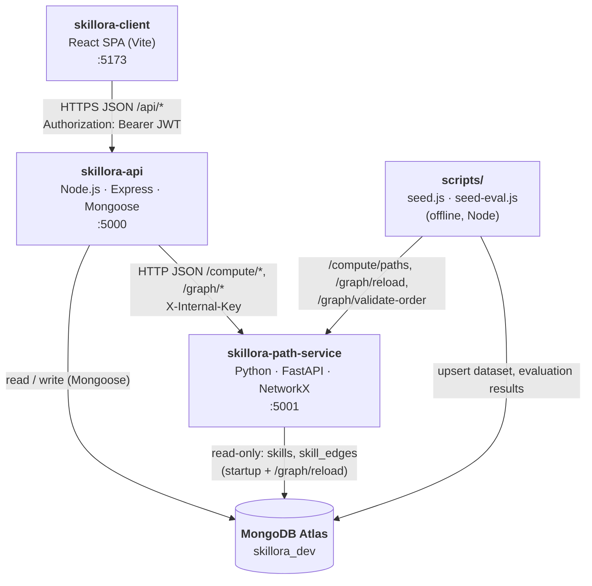
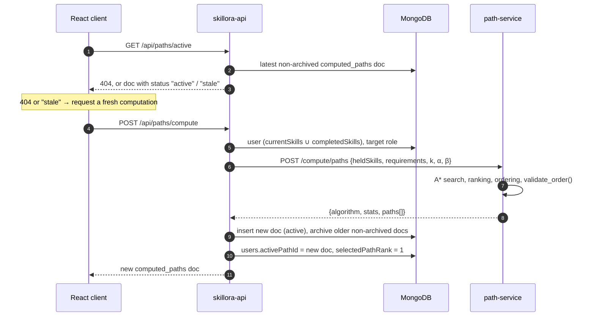
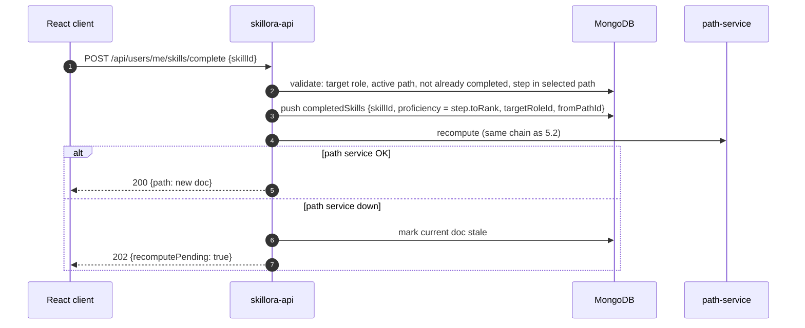
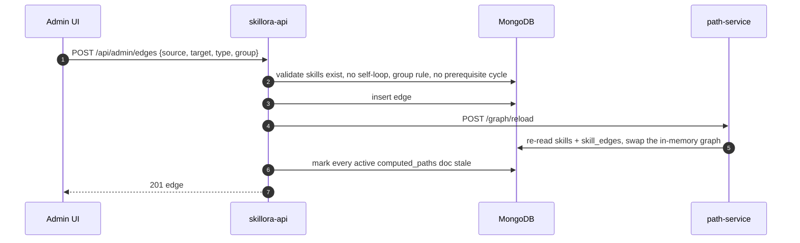
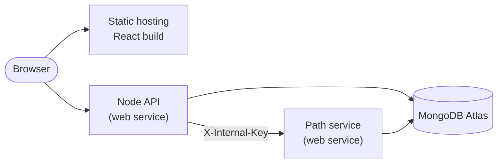

# SKILLORA — Architecture

| | |
|---|---|
| **Status** | Current as of 2026-10-15 (backend and path service implemented; frontend in progress) |
| **Related** | [PRD.md](PRD.md) · [DATA_MODEL.md](DATA_MODEL.md) · [API.md](API.md) · [ALGORITHM.md](ALGORITHM.md) · [ADRs](adr/README.md) |

This document describes how SKILLORA is built: its containers, their responsibilities and boundaries, the main runtime flows, and the security, reliability and deployment model. The reasoning behind each significant choice is recorded in the [architecture decision records](adr/README.md).

---

## 1. System context



SKILLORA has no other external dependencies: no email, payment, identity provider or third-party data feed.

## 2. Containers



| Container | Responsibility | Owns | Never does |
|---|---|---|---|
| **skillora-client** | All user interface: onboarding, roadmap, alternatives, graph explorer, progress, settings, admin | UI state; the JWT in the browser | Call the Python service; hold any secret |
| **skillora-api** | The only public API. Authentication and sessions, profiles, catalog, path lifecycle (compute, select, complete, history), admin curation, validation and business rules | Every database **write**; staleness and cascade rules | Run the search algorithm |
| **skillora-path-service** | Stateless graph computation: load the skill graph into memory, run A\* / Dijkstra, rank alternatives, generate rationales, report graph health | The in-memory `networkx.DiGraph` | Write to the database; know about users or sessions |
| **MongoDB Atlas** | Persistence for all seven collections ([DATA_MODEL.md](DATA_MODEL.md)) | Data | — |
| **scripts/** | Offline jobs: load `data/v1` into the database; run the D6 evaluation | — | Run as part of the live request path |

Why a separate Python service: [ADR-0001](adr/0001-separate-python-path-service.md).

## 3. Components

### 3.1 skillora-api (Node.js)

```
index.js                 app setup: env checks, CORS, JSON, routes, docs, 404 + error handler
middleware/auth.js       JWT verification + session lookup (DB-7) → req.user, req.tokenHash
middleware/adminOnly.js  reads users.role from the database (not from the JWT)
middleware/errorHandler  AppError / CastError / ValidationError / duplicate key → JSON { error }
routes/                  auth · users · skills · roles · stats · graph · paths · admin
services/computeService  the compute chain used by API-N-9 and API-N-14 (one in-flight compute per user)
services/pythonProxy     axios client for the path service (base URL, X-Internal-Key, timeout)
utils/                   cycle check, staleness helpers, proficiency ranks, token hashing, AppError
models/                  Mongoose schemas DB-1 … DB-7
docs/openapi.js          hand-written OpenAPI 3 document served at /api/docs
```

### 3.2 skillora-path-service (Python)

```
main.py          FastAPI app, X-Internal-Key dependency, routes
graph_loader.py  GraphStore (DiGraph + costs, demand, groups, corequisites); MongoDB or JSON loader;
                 one MongoClient reused across reloads
search.py        prepare (held-skill rule, relevant set, costs), A* / Dijkstra, greedy fallback,
                 ranking, step ordering, rationales
validate.py      validate_order()
models.py        Pydantic request/response models
tools/           dataset QA and stress check
```

## 4. Data ownership

| Collection | skillora-api | skillora-path-service | scripts |
|---|---|---|---|
| `users` | read / write | — | — |
| `sessions` | read / write | — | — |
| `skills` | read / write (admin) | **read** | write (`seed.js`) |
| `skill_edges` | read / write (admin) | **read** | write (`seed.js`) |
| `roles` | read / write (admin) | — | write (`seed.js`) |
| `computed_paths` | read / write | — | mark stale (`seed.js`) |
| `evaluation_scenarios` | — | — | write (`seed-eval.js`) |

The path service is read-only by design ([ADR-0001](adr/0001-separate-python-path-service.md)): the Node API sends it plain data (held skills and requirements) and persists the result itself.

## 5. Runtime flows

### 5.1 Request authentication

Every protected request carries `Authorization: Bearer <JWT>`. `middleware/auth.js` verifies the signature and expiry, hashes the token (SHA-256) and requires a matching document in `sessions`. Logout deletes that document, so a token is revoked immediately even before it expires ([ADR-0004](adr/0004-jwt-with-server-side-sessions.md)). Admin routes then re-read `users.role` from the database.

### 5.2 Computing a path (API-N-9)



Two concurrent computes for the same user share one in-flight request, so at most one new document is created. If the path service is unreachable or fails, the API marks the existing document `stale`, keeps it, and returns `503` ([ADR-0005](adr/0005-versioned-computed-paths.md)).

### 5.3 Completing a skill (API-N-14)



A completion is never lost. After a `202`, the path stays `stale` until the client calls `POST /api/paths/compute` again (for example on the next dashboard load); the server does not retry by itself.

### 5.4 Admin edit and graph reload



If the reload fails, the write still succeeds and a warning is logged; the next successful reload (or a service restart) picks the change up.

## 6. Security

| Concern | Mechanism |
|---|---|
| Passwords | bcrypt, 10 rounds; never returned by any endpoint |
| Authentication | JWT (`JWT_SECRET`, expiry `JWT_EXPIRES_IN`, default 7 days, unique `jti`) plus a server-side session per login; TTL index removes expired sessions |
| Authorisation | Protected routes require a valid session; admin routes check `users.role === "admin"` in the database |
| Brute force | `express-rate-limit`: 10 requests / minute / IP on register and login; `trust proxy` enabled in production so real client IPs are used |
| Service-to-service | Every path-service endpoint except `/health` requires `X-Internal-Key` ([ADR-0007](adr/0007-internal-api-key.md)); the key never reaches the browser |
| Input validation | ObjectId and enum checks in routes; Mongoose validators; regex input escaped in skill search; whitelisted fields on edge updates |
| Error hygiene | Unexpected errors return `500 Internal server error` without internals; details go to the server log |
| CORS | Only `CLIENT_ORIGIN` (default `http://localhost:5173`) |
| Secrets | `.env` files are git-ignored; `.env.example` holds placeholders only |

## 7. Reliability and failure modes

| Failure | Behaviour |
|---|---|
| Path service down or slow (timeout `PYTHON_TIMEOUT_MS`, default 5 s) | Compute returns `503`; the last path is kept as `stale`; completion returns `202` and is saved |
| Path service cannot reach MongoDB at startup | It starts without a graph and answers `503` until `/graph/reload` succeeds |
| Graph reload fails | The previous in-memory graph is kept |
| Search hits the 200 000-state cap | Returns the plans found so far (`stats.capped: true`), or a greedy plan if none |
| Duplicate concurrent computes | Deduplicated per user in `computeService` |
| Same-second double login | Distinct tokens (random `jti`), so no session collision |

## 8. Performance

| Operation | Measured |
|---|---|
| Compute, evaluation scenarios | ≤ 0.3 s in the path service |
| Compute, all 18 roles from an empty profile | slowest 622 ms ([D6 §8.5](D6_Evaluation_Report.md#85-all-18-roles-from-an-empty-profile-stress-test)) |
| Graph reload | ≈ 0.27 s (one reused MongoDB client) |
| Requirement | < 2 s end to end (NFR, [SRS NFR-1](SRS.md#4-non-functional-requirements)) |

The first MongoDB connection of the path service can take several seconds on networks with slow DNS; this is paid once at startup.

## 9. Configuration

| Variable | Service | Purpose |
|---|---|---|
| `PORT` | api | HTTP port (5000) |
| `NODE_ENV` | api | `production` enables `trust proxy` |
| `MONGO_URI` | api, path-service, scripts | MongoDB connection string (shared) |
| `JWT_SECRET`, `JWT_EXPIRES_IN` | api | Token signing secret and lifetime |
| `INTERNAL_API_KEY` | api, path-service | Shared service-to-service secret (same value in both) |
| `PYTHON_SERVICE_URL`, `PYTHON_TIMEOUT_MS` | api | Path-service location and request timeout |
| `CLIENT_ORIGIN` | api | Allowed CORS origin |
| `PYTHON_PORT`, `MONGO_DB`, `SKILLS_COLLECTION`, `EDGES_COLLECTION`, `MAX_STATES`, `COST_BOUND_RATIO` | path-service | Port and optional overrides |
| `VITE_API_BASE_URL` | client | Base URL of skillora-api (without `/api`) |

The template is [`.env.example`](../.env.example); setup steps are in [DEV_SETUP.md](DEV_SETUP.md).

## 10. Deployment

**Local development:** three processes (client 5173, api 5000, path service 5001) against the shared Atlas database `skillora_dev`.

**Target (v1 submission, pending):**



- Production values: `NODE_ENV=production`, `CLIENT_ORIGIN` = the frontend URL, `PYTHON_SERVICE_URL` = the path-service URL, `VITE_API_BASE_URL` = the API URL.
- Free tiers that sleep idle services need a longer `PYTHON_TIMEOUT_MS` (≈ 60 000) or a `/health` wake-up call.
- Atlas network access must allow the hosts' outbound IPs; the database user should have `readWrite` on the application database only.

## 11. Repository layout

```
skillora/
├── data/v1/                 dataset (skills, edges, roles) — D1
├── scripts/                 seed.js, seed-eval.js (offline jobs)
├── skillora-api/            Node.js API
├── skillora-path-service/   Python path service
├── skillora-client/         React SPA
├── docs/                    product, design and report documents (start at docs/README.md)
├── .env.example             environment template for all services
└── CONTRIBUTING.md          workflow and conventions
```
