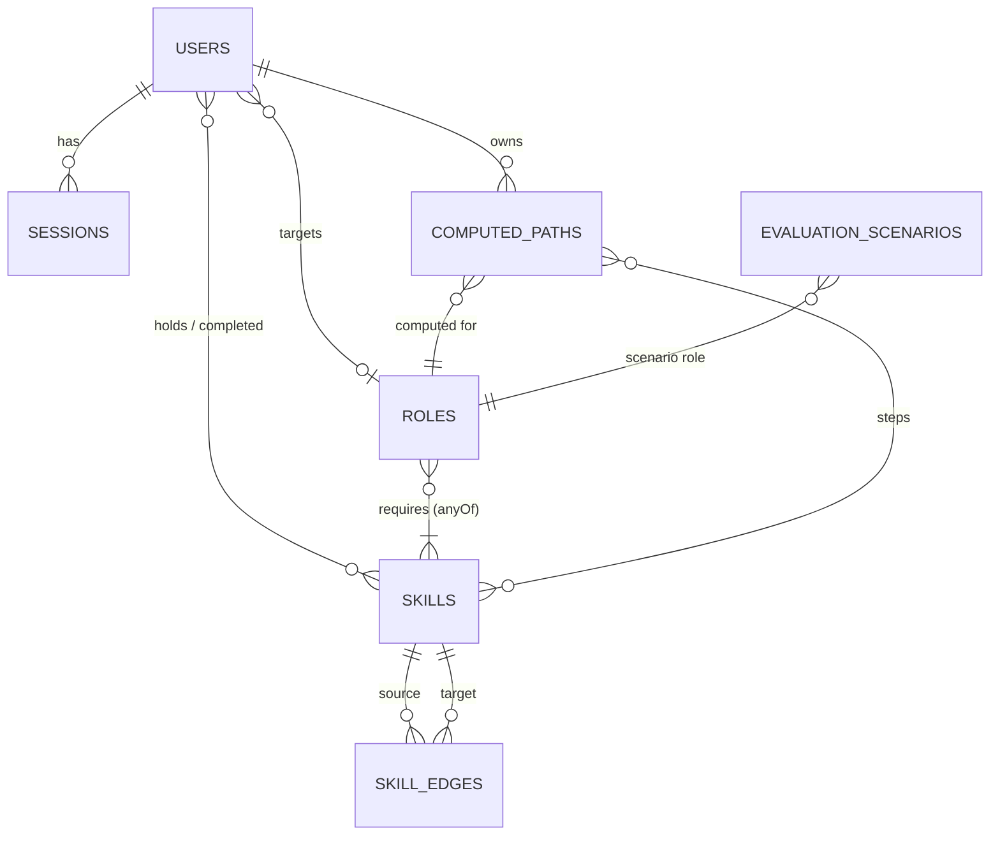

# SKILLORA — Data Model

| | |
|---|---|
| **Database** | MongoDB (Atlas), database `skillora_dev` |
| **Status** | Current (spec v4.1) |
| **Related** | [ARCHITECTURE.md](ARCHITECTURE.md) · [API.md](API.md) · [D1 dataset methodology](D1_Dataset_Methodology.md) |

Seven collections, identified as **DB-1 … DB-7**. The Node API owns every write; the path service only reads `skills` and `skill_edges` ([ARCHITECTURE §4](ARCHITECTURE.md#4-data-ownership)).

## Conventions

- **IDs.** Every field or route parameter named `…Id` or `:id` is a MongoDB `ObjectId`. Human-readable keys are always called `slug`.
- **Proficiency ranks.** `beginner = 1`, `intermediate = 2`, `advanced = 3`, and `0` = not known.
- **Held proficiency** of a skill = the highest rank recorded for it across `currentSkills` ∪ `completedSkills`.
- **Step cost.** Learning skill *s* from rank *r* to rank *t* costs `estHours(s) × (t − r) / 2` hours: zero → beginner = 0.5 × `estHours`, zero → intermediate = 1 ×, beginner → intermediate = 0.5 ×, zero → advanced = 1.5 ×.
- **Timestamps.** `createdAt` / `updatedAt` are maintained by Mongoose where shown.

| ID | Collection | Mongoose model | Purpose |
|---|---|---|---|
| DB-1 | `users` | `User` | Accounts, skill profile, target role, path pointers |
| DB-2 | `skills` | `Skill` | Graph nodes |
| DB-3 | `skill_edges` | `SkillEdge` | Graph edges |
| DB-4 | `roles` | `Role` | Target roles and their requirements |
| DB-5 | `computed_paths` | `ComputedPath` | Versioned path computations |
| DB-6 | `evaluation_scenarios` | `EvaluationScenario` | D6 benchmark results (offline) |
| DB-7 | `sessions` | `Session` | Server-side login sessions |

Collection names are pinned explicitly in the models ([ADR-0011](adr/0011-explicit-collection-names.md)).

## Entity relationships



---

## DB-1 `users`

```js
{
  _id: ObjectId,
  name: String,
  email: String,               // unique, stored lower-case
  passwordHash: String,        // bcrypt; never returned by the API
  role: "learner" | "admin",   // default "learner"; checked server-side for admin routes
  currentSkills: [             // self-reported profile
    { skillId: ObjectId, proficiency: "beginner" | "intermediate" | "advanced", addedAt: Date }
  ],
  completedSkills: [           // learned through SKILLORA paths
    { skillId: ObjectId,
      proficiency: "beginner" | "intermediate" | "advanced",   // level reached = the step's toRank
      targetRoleId: ObjectId,  // the role being pursued when it was completed
      completedAt: Date,
      fromPathId: ObjectId }   // the computed_paths document it came from
  ],
  targetRoleId: ObjectId | null,   // exactly one active role at a time
  activePathId: ObjectId | null,   // current computed_paths document
  selectedPathRank: Number,        // which ranked path inside that document; default 1, reset to 1 on recompute
  createdAt: Date,
  updatedAt: Date
}
```

Indexes: `email` (unique).

## DB-2 `skills` (graph nodes)

```js
{
  _id: ObjectId,
  slug: String,               // unique, e.g. "python-pandas"
  name: String,
  category: String,           // e.g. "programming" | "math" | "tool" | "domain" | "soft-skill"
  description: String,
  aliases: [String],          // alternative names, searched by typeahead
  baseDifficulty: Number,     // 1–5
  estHours: Number,           // hours from zero to intermediate; defaults to baseDifficulty × 8
  marketDemand: Number,       // 0–1, curated estimate of how often relevant postings mention the skill
  createdAt: Date,
  updatedAt: Date
}
```

Indexes: `slug` (unique). Search is a case-insensitive word-prefix match on `name` and `aliases` ([ADR-0009](adr/0009-word-prefix-skill-search.md)).

## DB-3 `skill_edges`

```js
{
  _id: ObjectId,
  sourceSkillId: ObjectId,    // the prerequisite (or one side of a corequisite pair)
  targetSkillId: ObjectId,    // the skill that needs it
  type: "prerequisite_of" | "corequisite_with",
  group: String | null,       // prerequisite_of only; null = mandatory
  source: String,             // curation note (reference type consulted)
  createdAt: Date
}
```

Indexes: `{sourceSkillId, targetSkillId, type}` (unique); `sourceSkillId`; `targetSkillId`.

**Semantics.** A skill can be learned once **all** its mandatory prerequisites are known **and** at least one member of each of its prerequisite groups is known. `corequisite_with` edges are informational (graph explorer, rationales) and never affect search or cycle checks. The `prerequisite_of` subgraph must be acyclic; this is enforced by `seed.js` and by the admin API.

## DB-4 `roles`

```js
{
  _id: ObjectId,
  slug: String,               // unique, e.g. "data-analyst"
  title: String,
  description: String,
  category: "data" | "engineering" | "design" | "product" | "management",
  demandScore: Number,        // 0–1, curated overall demand for the role (sorting / badges)
  requiredSkills: [
    { anyOf: [ObjectId],      // one id = mandatory skill; several = any one of them satisfies it
      label: String,          // optional group name, e.g. "BI tool"
      minProficiency: "beginner" | "intermediate" | "advanced" }
  ],
  createdAt: Date,
  updatedAt: Date
}
```

Indexes: `slug` (unique).

## DB-5 `computed_paths`

```js
{
  _id: ObjectId,
  userId: ObjectId,
  targetRoleId: ObjectId,
  generatedAt: Date,
  algorithm: "a_star" | "dijkstra" | "greedy_fallback",
  alpha: Number,              // weight of normalised cost (default 0.7)
  beta: Number,               // weight of (1 − market demand) (default 0.3)
  stats: {
    statesExpanded: Number,   // total search expansions
    statesToPrimary: Number,  // expansions when the first (cheapest) plan was found
    elapsedMs: Number,
    capped: Boolean           // true if the 200 000-state cap stopped the search
  },
  status: "active" | "stale" | "archived",
  paths: [
    {
      rank: Number,           // 1 = primary (lowest compositeScore)
      type: "primary" | "alternative",
      totalLearningCost: Number,   // hours
      marketDemandAvg: Number,     // mean marketDemand of the steps
      compositeScore: Number,      // α·(cost / maxCost) + β·(1 − marketDemandAvg); lower is better
      steps: [
        { skillId: ObjectId, order: Number, fromRank: Number, toRank: Number,
          estCost: Number, rationale: String }
      ]
    }
  ]
}
```

Indexes: `{userId, status}`, `{userId, generatedAt: -1}`.

**Lifecycle** ([ADR-0005](adr/0005-versioned-computed-paths.md)):

| Event | Effect |
|---|---|
| Successful compute (API-N-9, or inside API-N-14) | New document inserted as `active`; older non-archived documents of the user → `archived`; `users.activePathId` updated; `selectedPathRank` = 1 |
| Profile or target-role change (API-N-5, N-8, N-15, N-16) | The user's `active` document → `stale` |
| Any admin write to skills, edges or roles (API-N-18–25, N-29), or `seed.js` | Every `active` document → `stale` |
| Path service failure during a compute | The current document → `stale` and kept |
| Role deleted (API-N-29) | Affected users' non-archived documents → `archived`; `targetRoleId` and `activePathId` cleared |
| Account deleted (API-N-17) | The user's documents deleted |

Invariant: at most one non-archived document per user. When every requirement is already met, the document holds one primary path with `steps: []` and cost 0.

## DB-6 `evaluation_scenarios`

```js
{
  _id: ObjectId,
  scenarioName: String,       // unique
  currentSkills: [{ skillId: ObjectId, proficiency: String }],
  targetRoleId: ObjectId,
  humanExpertPath: [ObjectId],    // hand-authored benchmark
  systemPath: [ObjectId],         // rank-1 path, A* mode
  baselinePath: [ObjectId],       // generic roadmap: first anyOf option + prerequisites, from zero
  metrics: {
    systemHours: Number,
    baselineHours: Number,
    timeSavedPct: Number,           // (baseline − system) / baseline × 100
    redundantSkillsAvoided: Number,
    systemOrderViolations: Number,  // must be 0
    baselineOrderViolations: Number,// mean over 20 shuffles
    expertJaccard: Number,
    expertKendallTau: Number,
    statesExpandedAStar: Number,
    statesExpandedDijkstra: Number
  },
  createdAt: Date
}
```

Written only by `scripts/seed-eval.js` (offline); never by the web app. Full method in the [D6 report](D6_Evaluation_Report.md).

## DB-7 `sessions`

```js
{ _id: ObjectId, userId: ObjectId, tokenHash: String, expiresAt: Date }
```

Indexes: `tokenHash` (unique); TTL on `expiresAt` (`expireAfterSeconds: 0`). One document per login; deleted on logout or account deletion ([ADR-0004](adr/0004-jwt-with-server-side-sessions.md)).

---

## Dataset (v1)

The graph content is versioned as JSON in `data/v1/` and loaded by `node scripts/seed.js` (idempotent upsert, validation and cycle check). v1 contains 114 skills, 183 `prerequisite_of` and 22 `corequisite_with` edges, 11 prerequisite groups and 18 roles. File formats: [`data/README.md`](../data/README.md); curation method: [D1](D1_Dataset_Methodology.md).
