# SKILLORA User Guide

> **Status:** v1.1 · deliverable D7 (user guide) · wording matches the Transit interface (v4.2)
>
> **Live app:** <https://skillora-black.vercel.app>. The screenshots below show the current Transit interface in light mode (plus one dark-mode view), taken with sample data for the worked example.

SKILLORA builds you a personal, ordered learning roadmap for the job role you want. You tell it what you already know, pick a role, and it works out the shortest sensible sequence of skills to learn, explains why each one is there, and updates the plan as you make progress.

This guide walks through the app the way a new learner uses it. The screenshots follow one worked example: a learner who knows **Python (beginner)** and **SQL (intermediate)** and wants to become a **Data Analyst**.

## Contents

1. [Getting started](#1-getting-started)
2. [Onboarding](#2-onboarding)
3. [Dashboard](#3-dashboard)
4. [Comparing alternatives](#4-comparing-alternatives)
5. [Tracking progress](#5-tracking-progress)
6. [Graph Explorer](#6-graph-explorer)
7. [Settings](#7-settings)
8. [Admin curation](#8-admin-curation)
9. [Troubleshooting](#9-troubleshooting)

---

## 1. Getting started

### Create an account

Open SKILLORA and choose **Get started free** (or go to `/register`). Enter your full name, email and a password of at least 8 characters, then click **Create account**. You are signed in straight away and taken to onboarding.

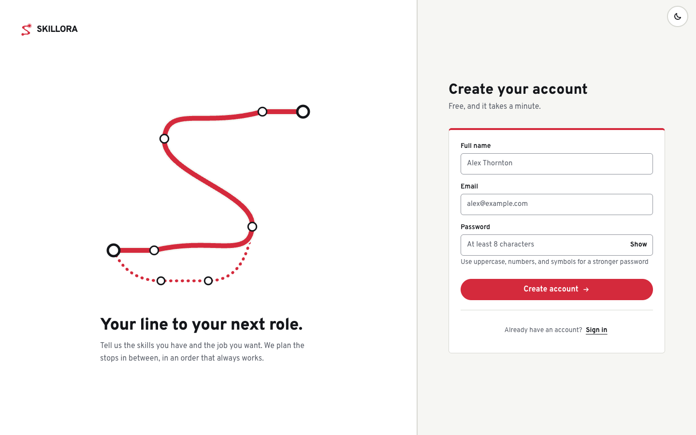

### Sign in

Already have an account? Go to **Sign in** (`/login`) and enter your email and password. If you have already chosen a target role you land on your dashboard; otherwise onboarding picks up where you left off.

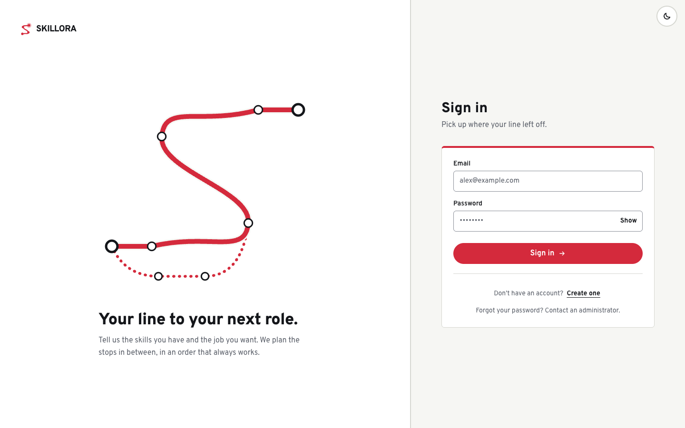

> Too many sign-in attempts in a short time are blocked for a minute. Wait and try again.

### Sign out

Go to **Settings → Account → Sign out**. This ends your session on the server as well as in the browser, so the old session can't be reused.

---

## 2. Onboarding

Onboarding has two steps, shown at the top of the page: **Your skills** and **Your destination**.

### Step 1: Your skills

Pick every skill you already have. Skills are grouped by domain (Cloud, Concept, Database, Programming, Tool…), and each one shows roughly how many hours it takes to learn. Use the search box to find a skill quickly.

Chosen skills appear in the **Your stations** panel, where you set how well you know each one: **beginner**, **intermediate** or **advanced**. Be honest but don't undersell yourself. A higher level can remove whole steps from your roadmap.

The **Next departures** board below it shows what your skills open up next. In the example, Python is set at *beginner* and SQL at *intermediate*. New to everything? Click **I'm starting from scratch**.

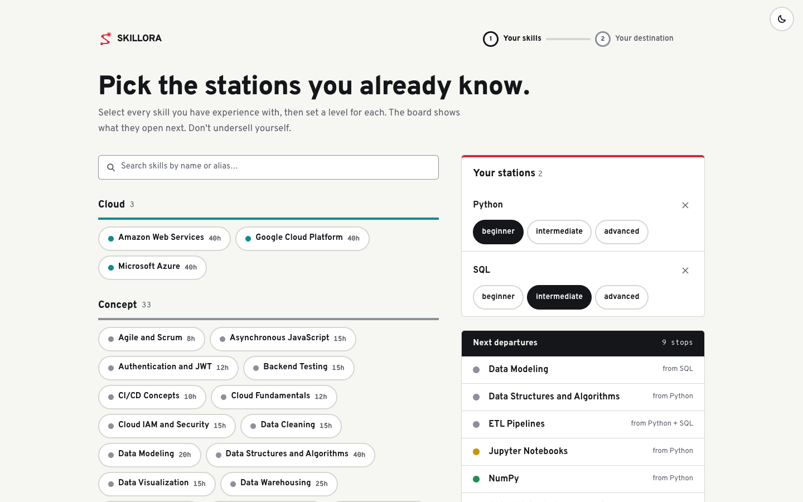

Click **Next: choose your destination**.

### Step 2: Target role

Roles are listed by field. Each row shows the role's **market demand** (for example *High demand*) and how many of its requirements you already meet (**has / needs**, for example *1/5 requirements met*). Click **Requirements** to see a short description and exactly which skills and levels the role requires, each marked *Have it*, *Need it* or *Have Beginner, need Intermediate*. Where any one of several tools will do (such as Power BI or Tableau) it says so. Sort or search to narrow the list.

Click a role to select it (it is marked *Selected*), then click **Generate my path** at the bottom of the page.

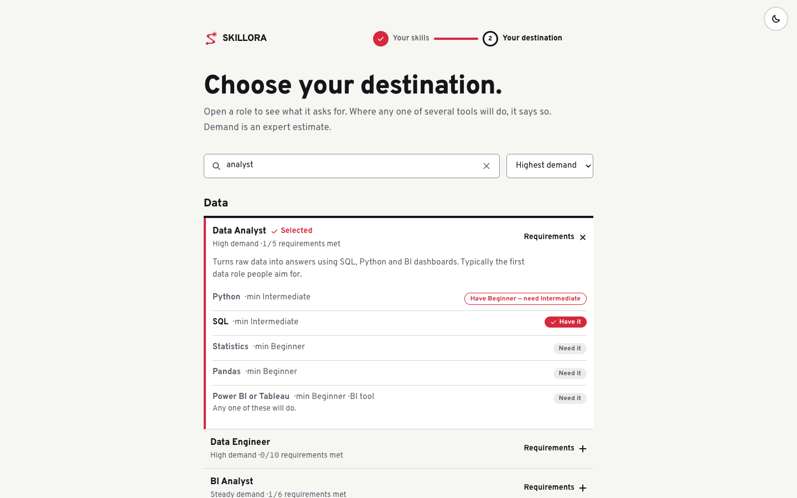

You can change your skills or your role later in [Settings](#7-settings); your roadmap is recomputed automatically.

---

## 3. Dashboard

The dashboard is your home page. It shows your roadmap as a metro line: each skill is a stop, and you ride from where you are now to your target role.

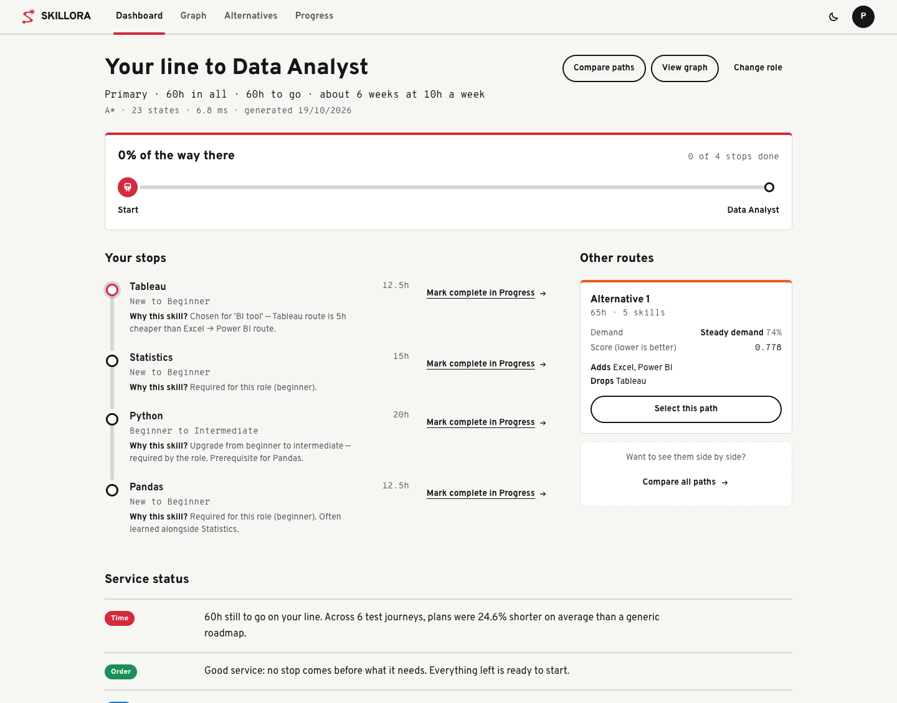

- **Header.** "Your line to" your role, plus a line with the route you are on, total hours, hours to go and an estimate at 10 hours of study per week. A second line says how the path was computed (search method, states explored, time taken and date). Buttons let you **Compare paths**, **View graph** or **Change role**.
- **Journey line.** A single horizontal line with a train showing how far along you are ("% of the way there") and how many stops are done.
- **Your stops.** Your skills in the order to learn them, drawn along the line. Each stop shows:
  - its estimated hours;
  - its state, shown by the marker on the line: **Up next** (the one to start now), **Available** (prerequisites done) or **Locked** (an earlier stop is still needed, with a line such as "Needs Python first");
  - the level change, e.g. *New → Beginner* or *Beginner → Intermediate*;
  - a plain reason why it is there, such as "Required for this role" or "Tableau route is 5h cheaper than Excel → Power BI route".
  Select a stop to open its skill details.
- **Other routes.** If more than one route exists, a short preview (hours, demand, score, and which skills it adds or drops) with **Select this path**.
- **Service status.** Time left, whether the order is valid (no stop comes before what it needs) and whether your plan is up to date. Scroll down to see it.

To record that you've learned a skill, open **Progress** and mark it complete there.

---

## 4. Comparing alternatives

Some roles let you choose between skills. The Data Analyst role needs *a* BI tool: Power BI **or** Tableau. Each choice gives a different route. Open **Alternatives** in the top bar (or **Compare paths** on the dashboard) to see them side by side. The screenshot is cut off after the first charts; scroll the page for the rest.

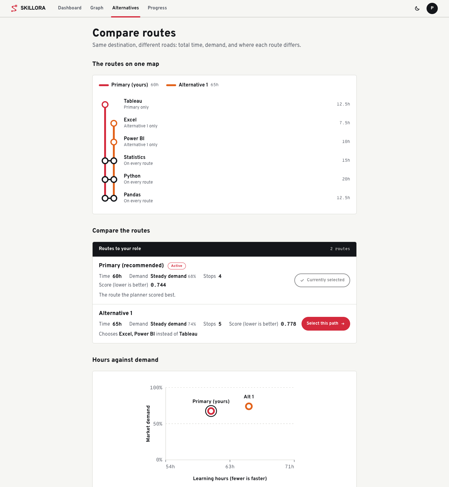

The page has three parts:

- **The routes on one map.** Every route is drawn as a line (your route in red, alternatives in other colours). Skills on every route sit where the lines meet; skills that belong to only one route are labelled *Primary only* or *Alternative 1 only*, each with its hours.
- **Compare the routes.** One row per route showing:
  - **Time**: total learning hours for the remaining steps.
  - **Demand**: the average market demand of the skills on that route.
  - **Stops**: how many skills it contains.
  - **Score**: a combined ranking. It mixes time (70 %) and demand (30 %): `0.7 × hours/maxHours + 0.3 × (1 − demand)`. **Lower is better.** The best-scoring route is marked *recommended*.
  - What the route chooses instead of the primary one (for example "Chooses Excel, Power BI instead of Tableau").
- **Hours against demand.** A chart placing each route by hours and market demand.

Click **Select this path** to switch to another route; your dashboard and progress follow it. Your active route is marked **Currently selected**.

> In the screenshot the learner has not started yet, so two routes exist: *Tableau* (60 h, primary) and *Excel → Power BI* (65 h). Once Tableau is finished, only one route is left ("Only one route exists for your profile").

---

## 5. Tracking progress

Open **Progress** in the top bar. The page is titled **Journey log**. The screenshots show the learner after finishing Tableau.

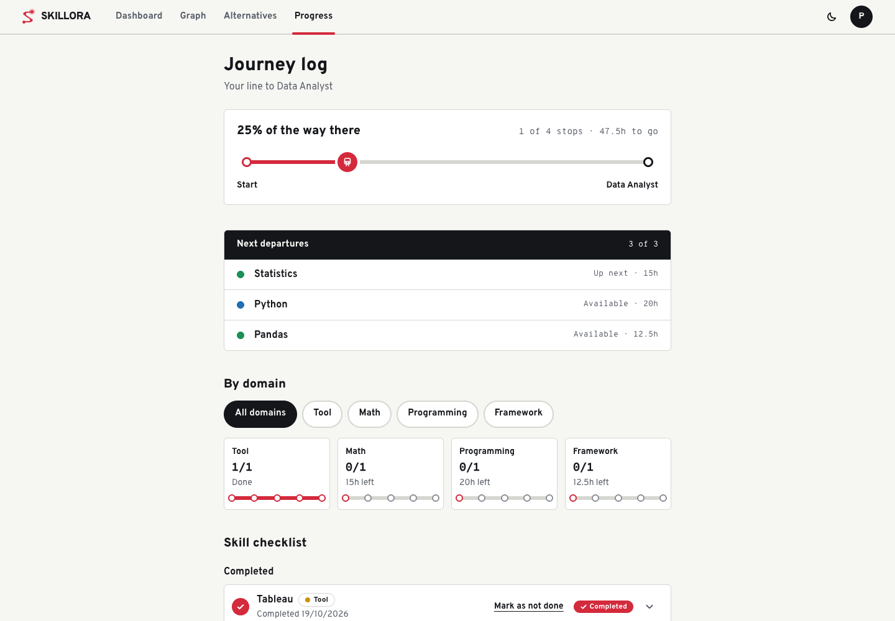

- **Journey line**: the same train-on-a-line view as the dashboard, with stops done and the percentage of the way there.
- **Next departures**: the skills you can start right now.
- **By domain**: how far along you are in each domain (Tool, Math, Programming…). Use the filter to focus on one domain.

### Mark a skill complete

In the **Skill checklist**, mark a skill complete from its row. SKILLORA records it and **recomputes your path** within a couple of seconds. A message such as "Tableau marked complete, path updated" confirms it, and it includes an **Undo** button. The message stays for 8 seconds, so you have time to use it if you clicked by mistake. Completed skills move to the *Completed* list with their date.

### Undo a completion

- **Right after marking:** click **Undo** in the message.
- **Later:** every completed skill has a **Mark as not done** button. It asks "Undo completion?" in place; choose **Yes** to confirm or **Cancel** to keep it.

Either way the skill returns to your path and the plan is recomputed.

### History

Scroll down for your record of what you've done.

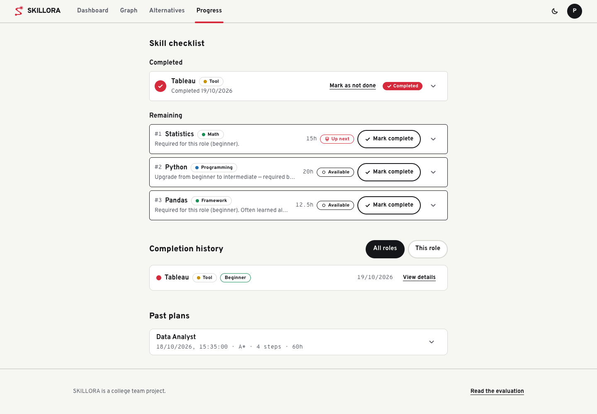

- **Completion history**: every skill you've completed, with level and date. Filter by *All roles* or *This role*, and click **View details** to read about the skill.
- **Past plans (archived snapshots)**: each time your path is recomputed, the old one is kept here with its date, method, number of steps and total hours. This lets you see how your plan changed over time.

### "Waking the planner" message

SKILLORA runs on free hosting, which puts the services to sleep when nobody has used them for a while. The first request after a quiet spell can take up to a minute. If something takes longer than a few seconds you will see "Waking the planner — free hosting sleeps when idle. This can take up to a minute." Just wait; it completes by itself.

### "Path service unavailable" banner

The roadmap is computed by a separate path-finding service. If that service is down when SKILLORA tries to recompute, you'll see a banner:

> **Path service unavailable — showing your last computed path** · **Retry**

Your completed skills are still saved. (When you mark or undo a skill while the service is down, you will see "Saved. Your path will update when the path service is back." and the plan refreshes once it returns.) The page keeps showing your previous path so you can carry on. Click **Retry** in a minute or two; once the service is back, the path updates. If you have no earlier path yet, the page shows "Path service unavailable" with a **Retry** button instead.

---

## 6. Graph Explorer

The Graph Explorer shows the whole skill map: every skill is a node, and the lines show which skills lead to which. Open **Graph** in the top bar.

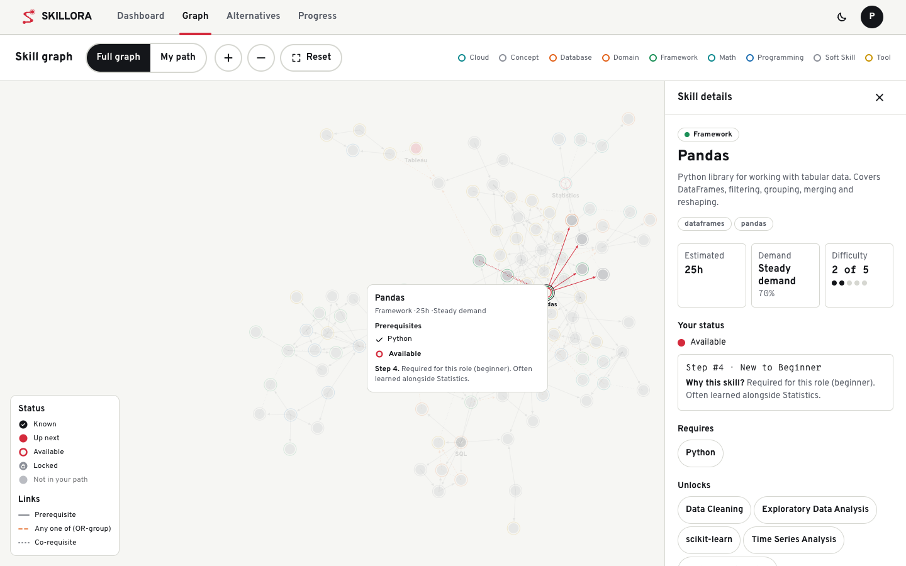

How to read it:

1. **Scope toggle: Full graph / My path.**
   - *Full graph* shows all 114 skills.
   - *My path* focuses on the skills in your roadmap and what you already know.
2. **Zoom controls: zoom in, zoom out and Reset.** You can also scroll to zoom and drag the background to pan.
3. **Domain colours** (toolbar, right). A node's outline colour shows its domain (Cloud, Database, Framework…).
4. **Status legend.** Each node's disc shows where the skill stands for *you*:
   - **Known**: you have it.
   - **Up next**: the next skill on your path.
   - **Available**: on your path, prerequisites done.
   - **Locked**: on your path, but a prerequisite is still missing.
   - **Not in your path**: faded.
5. **Link types.**
   - **Prerequisite** (solid line): learn the first skill before the second, e.g. Python → Pandas.
   - **Any one of (OR-group)** (dashed): *one* of these skills is enough, e.g. Power BI **or** Tableau for a BI requirement.
   - **Co-requisite** (dotted): skills best learned together; informational only.
6. **Hover cards.** Hover a node to see a card with its domain, hours, demand and a prerequisites list marked as held or missing. For a locked skill the card adds a line such as "Locked: still needs Python, one of Power BI / Tableau". It also shows your status and, if the skill is on your path, its step number and the reason. Its connections light up so you can see what it depends on and what it unlocks.
7. **Keyboard.** Nodes can be reached with **Tab**. Focusing a node shows the same hover card, and **Enter** or **Space** opens its details, so the graph works without a mouse.
8. **Select a node** to open the **Skill details** panel on the right. It shows:
   - the description and tags;
   - estimated hours, market demand and difficulty;
   - your status and the step it occupies on your path, with the reason;
   - **Requires** (prerequisites) and **Unlocks** (skills it leads to).

   Close it with the close button.

The same view in **dark mode**: switch with the sun/moon button in the top bar, or in Settings.

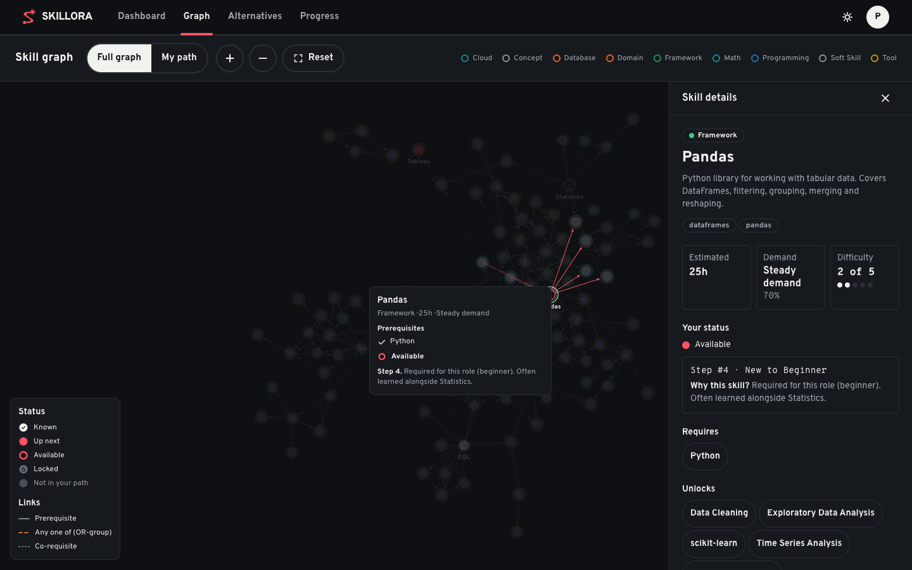

---

## 7. Settings

Open Settings from the account menu (top right). There are three tabs: **Account**, **My skills** and **Target role**.

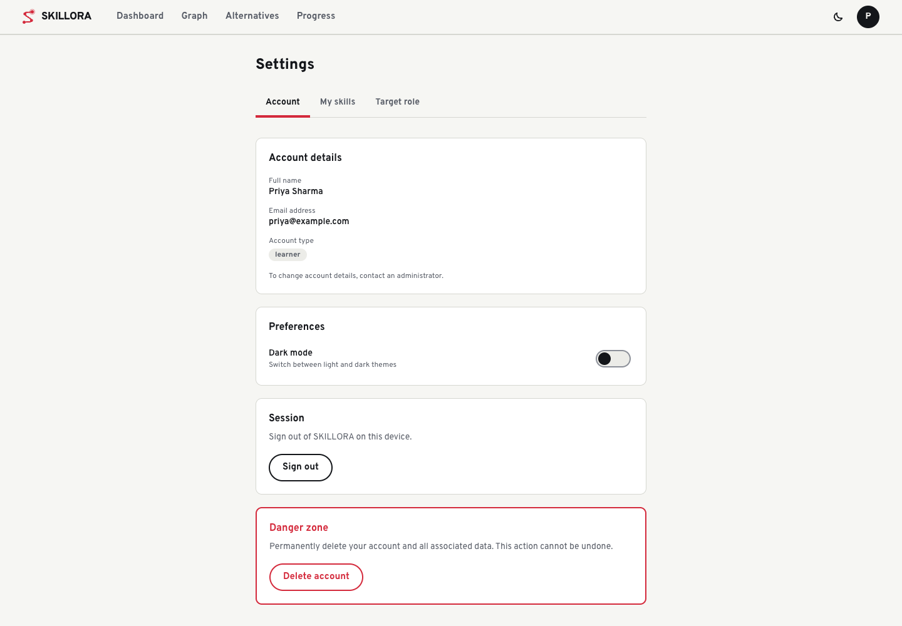

- **Account**
  - Your name, email and account type. To change your details, contact an administrator.
  - **Dark mode** switch.
  - **Sign out**.
  - **Danger zone → Delete account**: permanently removes your account, progress and saved paths. You'll be asked to confirm. This can't be undone.
- **My skills**: add or remove skills and change your proficiency. Your path is recomputed after a change.
- **Target role**: switch to a different role. Your roadmap is rebuilt for the new role, and your old path is kept in history.

---

## 8. Admin curation

Administrators maintain the skill graph that every roadmap is built from. Admin accounts see an extra **Admin** item in the top bar. Ordinary learners never see it, and the server refuses admin actions from them.

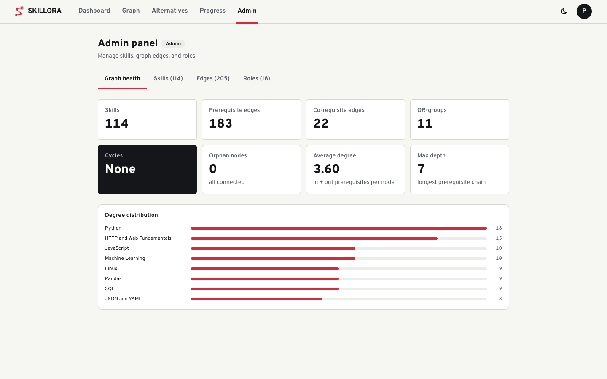

The Admin panel has four tabs:

- **Graph Health**: a check-up of the dataset.
  - Number of skills, prerequisite and co-requisite edges, and OR-groups.
  - **Cycles**: must be *None*. A skill can't depend on itself through a chain.
  - Orphan nodes (skills with no connections), average degree and maximum prerequisite depth.
  - A degree distribution of the most connected skills.
- **Skills**: search, add, edit or delete skills (name, domain, hours, demand, difficulty, tags). A skill can't be deleted while a role still requires it.
- **Edges**: add or remove links between skills. The server rejects any prerequisite that would create a cycle.
- **Roles**: create and edit roles and their required skills, levels and OR-choices.

Every change to the graph marks all learners' paths as out of date. Each learner's roadmap is recomputed automatically the next time they open it, so admins should make changes deliberately.

---

## 9. Troubleshooting

| Problem | What to do |
|---|---|
| "Invalid email or password" | Check the email and password; passwords are case-sensitive. There is no self-service password reset; ask an administrator. |
| "Too many requests" when signing in | You've hit the sign-in limit. Wait a minute and try again. |
| You're suddenly sent back to the sign-in page | Your session expired or was ended (for example, you signed out elsewhere). Sign in again; your data is safe. |
| The page says "Waking the planner" | Free hosting was asleep. Wait up to a minute; no action needed. |
| "Path service unavailable" banner | The path-finding service is temporarily down. Your progress is saved; click **Retry** later. See [section 5](#path-service-unavailable-banner). |
| A page shows "Couldn't load…" with **Retry** | A temporary network or server problem. Click **Retry**, or refresh the page. |
| The roadmap is empty / "You already meet every requirement" | You already have every skill the role needs. Pick a more advanced role in Settings → Target role. |
| Only one route on the Alternatives page | Your skills (or the role) leave only one sensible route. Alternatives appear when a role offers a choice you haven't made yet. |
| You can't find the Admin page | Only administrator accounts can open it. |
| The graph is cluttered | Switch to **My path**, zoom in with **+**, or click **Reset**. |
| Wrong colours or hard-to-read text | Toggle dark mode with the sun/moon button in the top bar. |

Still stuck? Contact your SKILLORA administrator or the project team.
